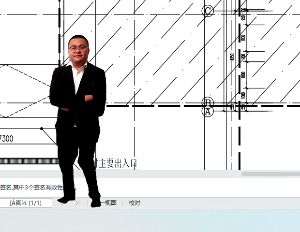
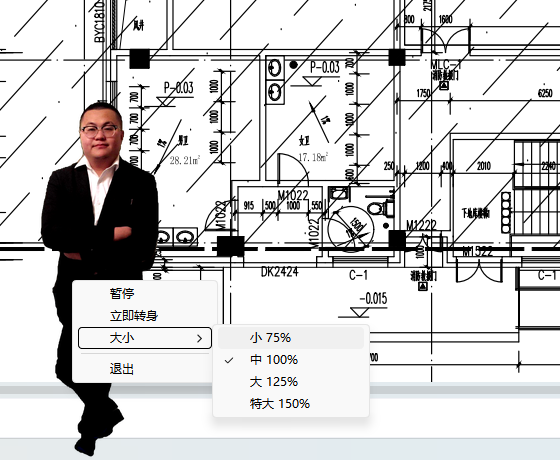

# 孙笑川「闲庭信步」桌面宠物

一个 Windows 桌面宠物：孙笑川在你屏幕最下方左右来回走，循环播放「闲庭信步」动作，碰到屏幕边缘就转身。
无边框、始终置顶、**逐像素透明**（Win32 分层窗口），人物边缘平滑无锯齿。



## 特性

- **真透明**：`WS_EX_LAYERED` + `UpdateLayeredWindow` 逐像素 alpha，不是色键抠图，边缘没有锯齿/粉边
- **动作循环**：168 帧 RGBA、15fps 循环播放
- **来回走**：默认朝右，碰到右边转身朝左，碰到左边再转回来
- **可调大小**：右键「大小」四档（75% / 100% / 125% / 150%），选中立即生效，并记住上次选择
- **右键菜单**：暂停 / 继续、立即转身、大小、退出
- **左键拖动**：可以把它拖到屏幕任意位置
- **开机自启**：可选，登录 Windows 后自动在后台启动
- **轻量**：纯 Python（Pillow + numpy + ctypes），没有 Tk/Qt/Electron

## 环境要求

- Windows 10 / 11
- Python 3.10+
- 依赖：

```bash
pip install -r requirements.txt
```

## 快速开始

```bash
git clone https://github.com/maoqizheng1/sunxiaochuan-desktop-pet.git
cd sunxiaochuan-desktop-pet
pip install -r requirements.txt
```

然后双击 `启动桌宠.vbs`（后台运行，不会弹黑框）。

如果双击没反应，通常是脚本找不到 `pythonw.exe`。把它的完整路径写进项目根目录的
`python_path.txt`（一行，不要引号），例如：

```text
C:\Python312\pythonw.exe
```

或者把 Python 的安装目录加入 PATH 后重试。

> 退出：右键桌宠 →「退出」，或双击 `关闭桌宠.bat`（会结束所有实例）。

## 操作

| 操作 | 效果 |
|---|---|
| 左键按住拖动 | 把桌宠拖到任意位置（松手后拉回屏幕内） |
| 右键 → 暂停 / 继续 | 冻结 / 恢复动作和移动 |
| 右键 → 立即转身 | 掉头朝反方向走 |
| 右键 → **大小** | 75% / 100% / 125% / 150% |
| 右键 → 退出 | 关闭桌宠 |

> 点击桌宠会正常激活窗口，但它使用了 `WS_EX_TOOLWINDOW`，不会出现在任务栏 / Alt+Tab 里。

## 大小与配置

右键 →「大小」选一个尺寸，会立刻生效，并写入同目录的 `pet_config.json`：

```json
{
  "scale": 1.25
}
```

下次启动自动套用。支持 `0.75`、`1.0`、`1.25`、`1.5`，文件不存在或值不合法时回落到 100%。



| 比例 | 窗口尺寸 |
|---|---|
| 75% | 96 × 270 |
| 100% | 128 × 360（默认） |
| 125% | 160 × 450 |
| 150% | 192 × 540 |

## 开机启动

```text
设置开机启动.bat    # 添加/修复启动项
取消开机启动.bat    # 移除启动项
```

- 启动项位置：`%APPDATA%\Microsoft\Windows\Start Menu\Programs\Startup\孙笑川桌宠.lnk`
- 只对当前用户生效，登录后启动，不需要管理员权限
- 也可以在「任务管理器 → 启动应用」里禁用/启用
- 移动了项目文件夹后，重新运行一次 `设置开机启动.bat` 修复路径

## 文件结构

```text
.
├─ 启动桌宠.vbs          # 双击启动（隐藏窗口）
├─ 关闭桌宠.bat          # 双击关闭
├─ close_pet.ps1         # 结束所有 desktop_pet.py 进程
├─ 设置开机启动.bat      # 添加/修复开机启动项
├─ 取消开机启动.bat      # 移除开机启动项
├─ add_autostart.ps1
├─ remove_autostart.ps1
├─ desktop_pet.py        # 主程序（Win32 分层窗口）
├─ frames/
│  ├─ 75/   (96×270)     # 168 张 RGBA 帧（平滑 alpha）
│  ├─ 100/  (128×360)
│  ├─ 125/  (160×450)
│  └─ 150/  (192×540)
├─ python_path.txt       # 可选：指定 pythonw.exe 路径（已被 .gitignore 忽略）
├─ pet_config.json       # 改过大小后生成（已被 .gitignore 忽略）
├─ 预览_桌面效果.png
├─ 预览_大小菜单.png
├─ tools/
│  └─ build_frames.py    # 从 _tmp/raw 生成四档 RGBA 帧
├─ README.md
├─ NOTICE.md
└─ LICENSE
```

## 重新生成帧（可选）

想改人物大小、裁剪范围或换素材，需要本机有 ffmpeg：

```bat
:: 1. 抽全分辨率 RGBA 帧（软抠像）到 _tmp/raw
ffmpeg -i "02_孙笑川站立_绿幕循环_11.1s_1920x1080.mp4" ^
  -vf "chromakey=0x00ff00:0.10:0.05,crop=355:1001:821:51" ^
  -r 15 -pix_fmt rgba "_tmp/raw/f_%%04d.png"

:: 2. 去绿边 + 预乘 alpha 缩放，生成 75/100/125/150 四档
python tools/build_frames.py
```

- `crop=355:1001:821:51`：原视频 1920×1080 里的人物裁剪框
- `chromakey=0x00ff00:0.10:0.05`：颜色:相似度:混合度，边缘太毛调大相似度，抠掉衣服就调小
- `-r 15`：抽帧帧率；改 20/25 更顺滑，但帧数和内存会变大
- 100% 档高度由 `tools/build_frames.py` 的 `BASE_H = 360` 决定

> `frames/` 里必须是 **RGBA 透明 PNG**；换成洋红底 RGB 帧会出现硬边/色块。

## 常见问题

**1. 双击 `启动桌宠.vbs` 没反应？**
脚本找不到 `pythonw.exe`。按上面的方法写 `python_path.txt`，或把 Python 加入 PATH。
也可以在命令行运行 `python desktop_pet.py` 看报错。

**2. 边缘有锯齿 / 透明不对？**
本项目使用分层窗口逐像素 alpha，正常情况边缘是平滑的。如果看到硬边，多半是 `frames/`
被换成了旧的洋红底帧；重新运行 `python tools/build_frames.py`。

**3. 大小选了没反应？**
看 `pet_config.json` 是否写入了新的 `scale`，以及 `frames/<比例>/` 是否存在。
配置文件用 UTF-8 保存即可（带不带 BOM 都行）。

**4. 被任务栏 / 其他窗口盖住？**
它是置顶窗口；全屏游戏、全屏视频会盖住它。程序使用主屏工作区，任务栏在底部时会站在任务栏上沿。

**5. 多显示器？**
只识别主屏，桌宠只在主屏横向来回走。

## 素材来源与版权

- 动作素材来自 B 站：`【高清重置】走路的孙笑川.gb`（UP：蒙古的上单）
  <https://www.bilibili.com/video/BV1S4411m7ko>
- 人物形象与原始视频版权归原 UP 主及孙笑川本人所有。
- 本仓库仅用于学习交流与桌面玩梗，**请勿商用**。如有侵权，请联系仓库作者删除。
- 代码（`desktop_pet.py`、`tools/`、启动脚本等）以 [MIT License](LICENSE) 发布；
  图片/视频帧素材不在 MIT 许可范围内，详见 [NOTICE.md](NOTICE.md)。
